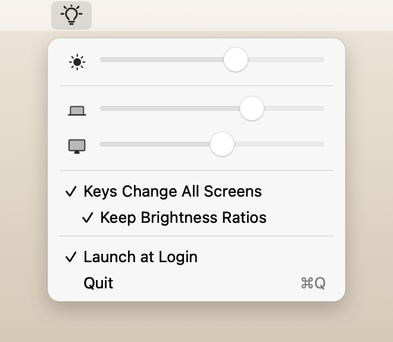
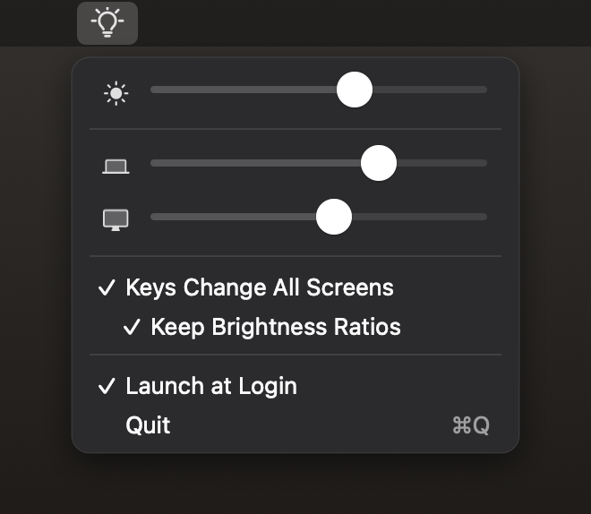

# Bulb

A tiny Mac menu bar app that sets the brightness of every screen, the laptop and your external monitors, from one place.

<p>


</p>

## Why
macOS only dims the laptop screen. Plug in a monitor and you are back to poking the buttons on its back. Bulb fixes that:

- **One slider for everything**: the top slider dims all screens together. Below it, one slider per screen, left to right as they are arranged.
- **Brightness keys reach every screen**: the usual keys now move your monitors too, with a small bar on each one so you see where it is.
- **Keep ratios**: match the screens by eye once, and from then on they dim together and still look the same.
- **Stays in sync**: the sliders follow changes made from the keys, Control Center and auto-brightness.
- **Nothing to approve**: sandboxed, no Accessibility or Input Monitoring access. About 700 lines of Swift you can read in one sitting.

## Who it's for
Anyone with an Apple Silicon Mac and an external monitor who is tired of two brightness controls.

Tested daily on an M1 MacBook Air with a Dell monitor on macOS 15. Monitors are dimmed over DDC, the same channel their own buttons use. Most monitors support it; some TVs, docks and adapters don't, and those show a greyed-out slider.

## Install
You need macOS 13 or newer and Apple's command line tools (run `xcode-select --install` if you don't have them).
```bash
git clone https://github.com/lukaskornis/Bulb && cd Bulb
./build.sh install
```
That builds the app, copies it to Applications and opens it. Look for the bulb in the menu bar, and tick Launch at Login in its menu to keep it around.

The first build makes a local signing certificate, "Bulb Local Signing", in your login keychain, so macOS sees every rebuild as the same app.

Update with `git pull && ./build.sh install`. To remove it, pick Quit in its menu and delete Bulb from Applications.

## Good to know
- Bulb uses private Apple APIs for the laptop screen and for DDC, so a macOS update could break it.
- How it works, in detail: [Bulb.md](Bulb.md).

## License
MIT.
